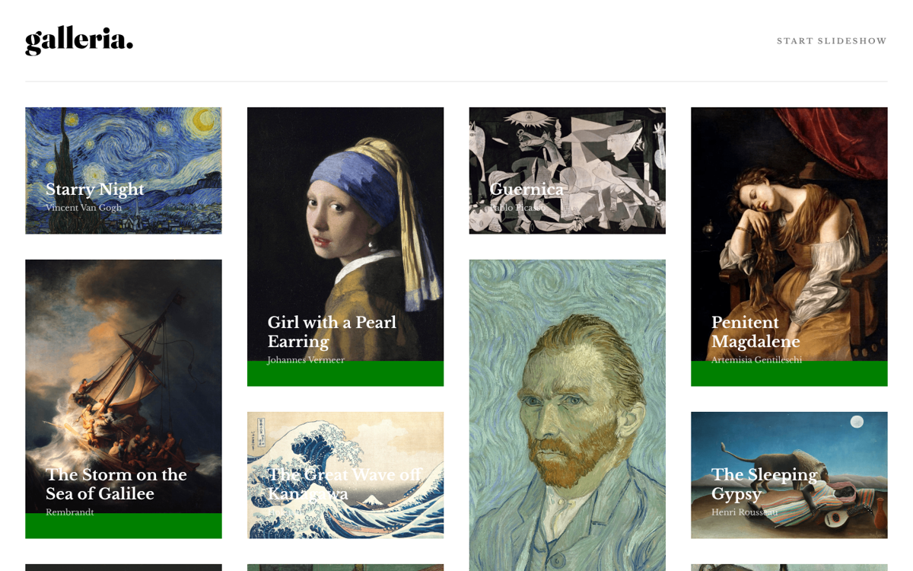

# Galleria — Art Gallery

Masonry-style gallery of famous paintings with title and artist overlays, based on a Frontend Mentor design.

**Live demo:** https://nodirkhuja.github.io/galleria/

## Built with
HTML5, CSS3 (Grid/columns)

## About
Learning project from my frontend development course (2022–2023). Layout is built for desktop screens.

Today I focus on AI agents and business automation (n8n, ERP/CRM and API integrations, Telegram bots).
